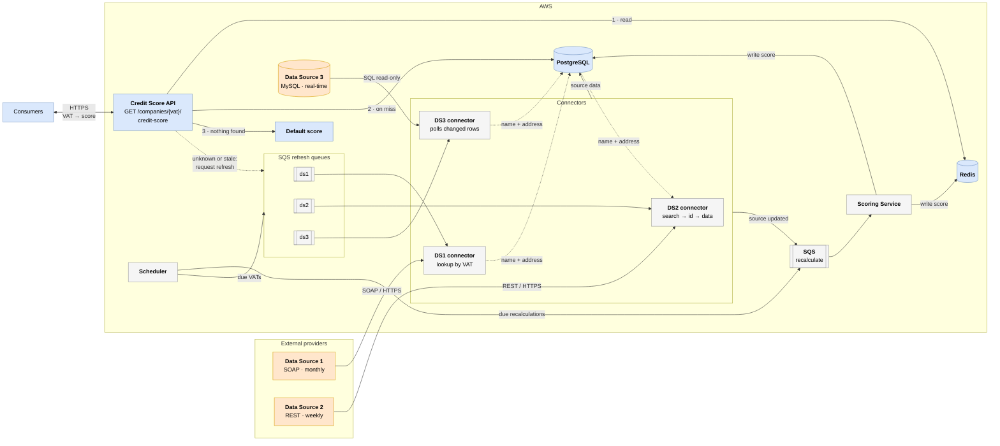
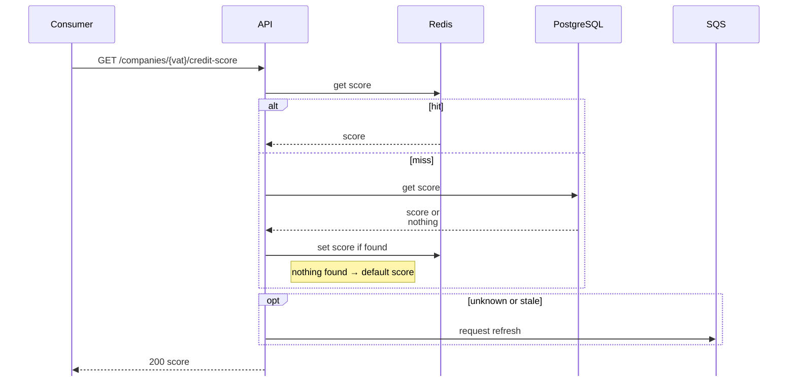
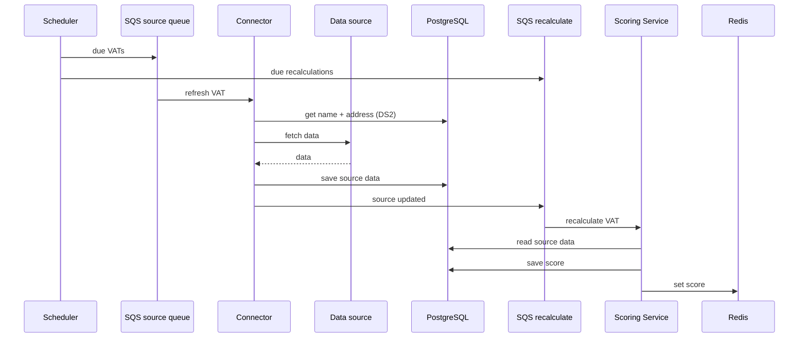
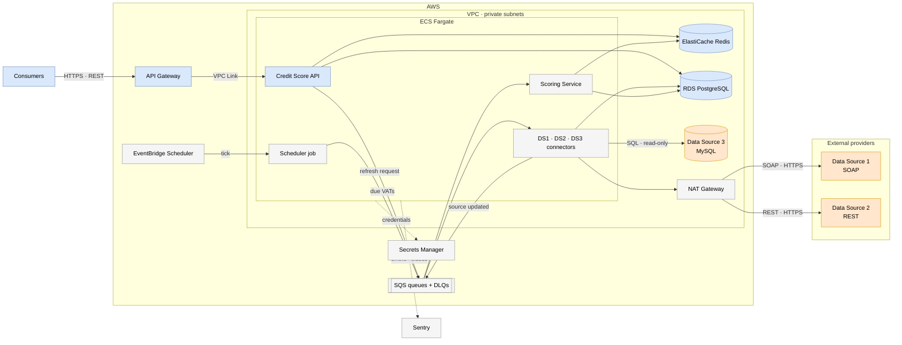
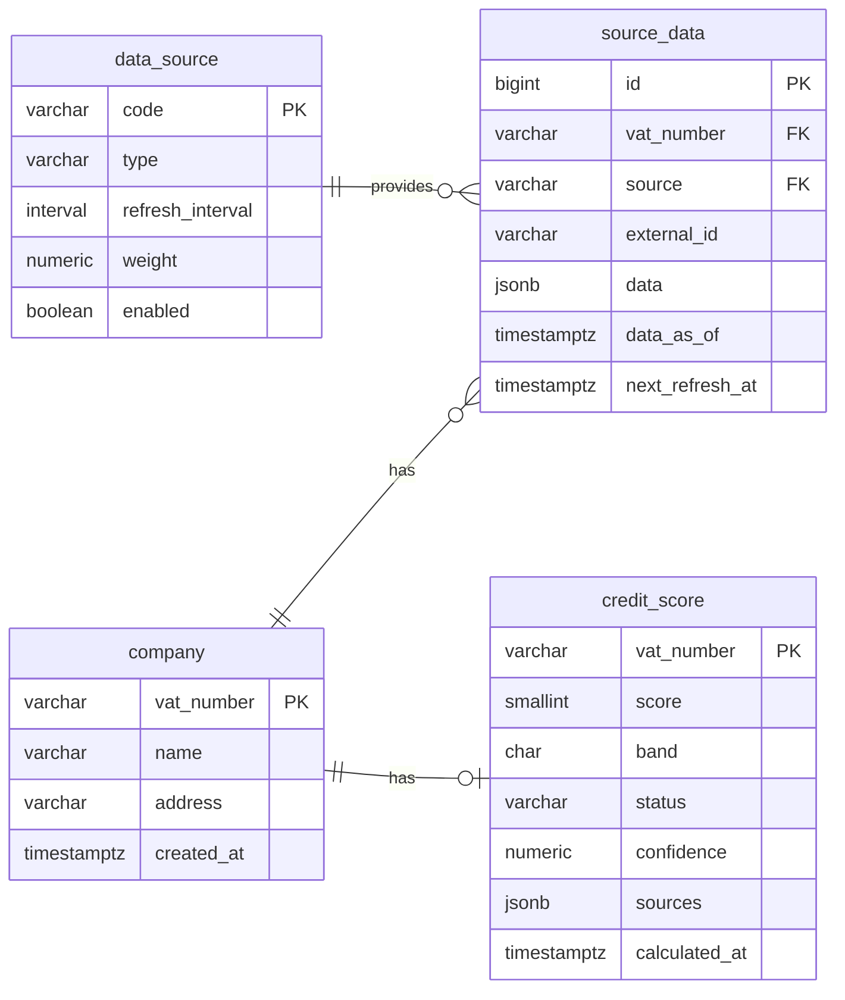

# Credit Score Service: overview



## GET /companies/{vat}/credit-score

### Known VAT

```json
{
  "vatNumber": "DE123456789",
  "score": 72,
  "band": "B",
  "status": "PARTIAL",
  "confidence": 0.92,
  "calculatedAt": "2026-11-24T09:15:02Z",
  "sources": [
    { "source": "ds1_rating_soap", "state": "OK",    "dataAsOf": "2026-11-03T00:00:00Z" },
    { "source": "ds2_credit_rest", "state": "STALE", "dataAsOf": "2026-11-10T00:00:00Z" },
    { "source": "ds3_internal",    "state": "OK",    "dataAsOf": "2026-11-24T09:14:40Z" }
  ]
}
```

### Unknown VAT

```json
{
  "vatNumber": "DE999999999",
  "score": 30,
  "band": "D",
  "status": "PROVISIONAL",
  "confidence": 0,
  "calculatedAt": null,
  "sources": []
}
```

## Processes

### Read a score



### Refresh



## Infrastructure



## Database



## Assumptions

- DS3 is in the same AWS private cloud.
- DS1 or DS3 provides the company's name and address.
